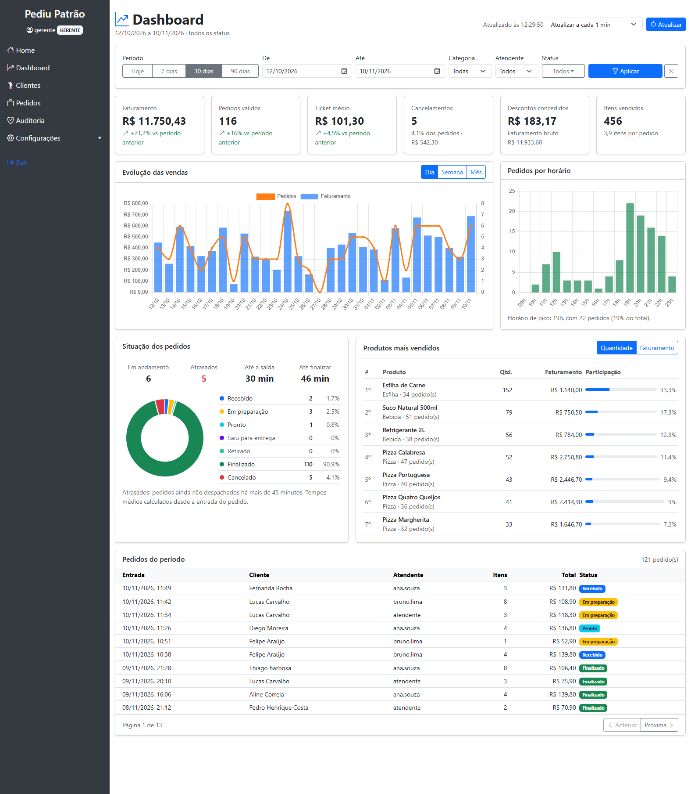
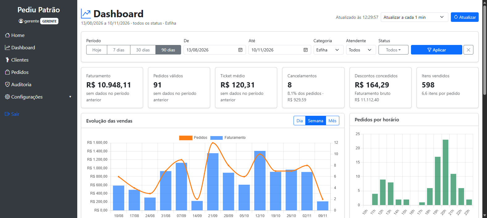
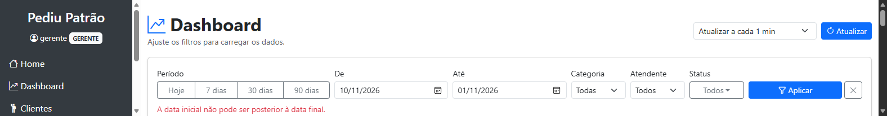
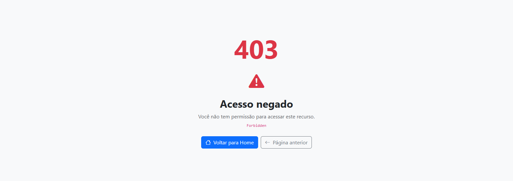

# Dashboard Administrativo — PediuPatrão

[](https://github.com/plugiin1/Pizzaria-PediuPatrao/actions/workflows/testes.yml)

Documentação: um painel administrativo integrado ao sistema de pedidos PediuPatrão, alimentado por uma API REST projetada para essa finalidade. O painel permite ao responsável pelo estabelecimento acompanhar o desempenho das vendas, a situação dos pedidos e as tendências da operação.



## Sumário

1. [Contexto e escopo](#1-contexto-e-escopo)
2. [Requisitos funcionais](#2-requisitos-funcionais)
3. [Requisitos não funcionais](#3-requisitos-não-funcionais)
4. [Regras de cálculo dos indicadores](#4-regras-de-cálculo-dos-indicadores)
5. [Projeto da solução](#5-projeto-da-solução)
6. [Documentação da API](#6-documentação-da-api)
7. [Evidências de testes](#7-evidências-de-testes)
8. [Como executar](#8-como-executar)
9. [Organização do código e gitflow](#9-organização-do-código-e-gitflow)

## 1. Contexto e escopo

O PediuPatrão já registrava clientes, produtos e pedidos com controle de status, descontos, cancelamentos e auditoria (parte 1). Faltava uma visão consolidada para a tomada de decisão: quanto se vendeu, em que horários, quais produtos saem mais, quantos pedidos estão atrasados e como o período atual se compara ao anterior.

**Usuários do dashboard:** perfis `ADMIN` e `GERENTE`, que representam o responsável pelo estabelecimento. O perfil `ATENDENTE` não tem acesso, pois a informação é gerencial.

**Fonte de dados:** a coleção `pedidos` do MongoDB, mantida pelo próprio sistema. O dashboard é somente leitura: nenhuma tela ou rota do painel altera dados.

## 2. Requisitos funcionais

| Código | Requisito | Descrição | Como foi atendido |
|---|---|---|---|
| RF01 | Indicadores gerais de vendas | Exibir faturamento, quantidade de pedidos, ticket médio, cancelamentos, descontos e itens vendidos do período, com comparação ao período anterior. | Endpoint `GET /api/dashboard/resumo`; seis cartões no topo do painel com variação percentual em relação ao período anterior de mesma duração. |
| RF02 | Análise de vendas (gráficos) | Mostrar a evolução das vendas ao longo do tempo e a distribuição por horário. | `GET /api/dashboard/vendas` (por dia, semana ou mês) e `GET /api/dashboard/vendas/horarios`; gráfico combinado de faturamento e pedidos e gráfico de barras por hora com destaque do horário de pico. |
| RF03 | Situação dos pedidos | Apresentar a quantidade de pedidos em cada status, os pedidos em andamento e atrasados e os tempos médios de atendimento. | `GET /api/dashboard/pedidos/status`; gráfico de rosca, tabela por status e indicadores de atraso e tempo médio. A lista paginada `GET /api/dashboard/pedidos` complementa a consulta. |
| RF04 | Produtos mais vendidos | Classificar os produtos por quantidade vendida ou por faturamento. | `GET /api/dashboard/produtos/mais-vendidos`; ranking com participação percentual e alternância entre os critérios. |
| RF05 | Filtros de consulta | Permitir restringir todas as informações por período, status, categoria de produto e atendente. | Parâmetros comuns aceitos por todos os endpoints; formulário com atalhos de período. As opções disponíveis vêm de `GET /api/dashboard/filtros`. Os filtros ficam registrados na URL da página. |
| RF06 | Integração com a API | O painel deve obter todos os dados por meio da API. | A página não recebe dados do servidor ao ser renderizada: o JavaScript consome os sete endpoints via `fetch`, em paralelo. |
| RF07 | Atualização e tratamento de dados | Manter os dados atualizados e tratar ausências, erros e valores inválidos. | Atualização automática configurável e manual; validação dos filtros no navegador e na API; preenchimento de períodos sem venda com zero; mensagens para períodos vazios; falha de uma seção não interrompe as demais; correção de pedidos antigos sem categoria. |

## 3. Requisitos não funcionais

| Código | Categoria | Requisito | Implementação |
|---|---|---|---|
| RNF01 | Segurança | Somente `ADMIN` e `GERENTE` acessam o dashboard e sua API. | Regra por rota no `SecurityConfig` e `@PreAuthorize` no `DashboardService` (duas camadas). Testado em `DashboardApiTest`. |
| RNF02 | Segurança | A API do dashboard é somente leitura. | Apenas `GET` é permitido; qualquer outro método em `/api/dashboard/**` é negado com `403`. |
| RNF03 | Privacidade | O painel não expõe dados pessoais além do necessário. | As respostas trazem apenas o nome do cliente; telefone e endereço não são retornados. |
| RNF04 | Desempenho | As consultas devem ser processadas no banco, sem carregar todos os pedidos na aplicação. | Pipelines de agregação do MongoDB (`$match`, `$group`, `$unwind`, `$dateTrunc`, `$hour`) e índice em `dataHoraEntrada`. |
| RNF05 | Desempenho | O volume de cada consulta deve ser limitado. | Período máximo de 366 dias, ranking de 1 a 50 itens e páginas de 1 a 100 pedidos. |
| RNF06 | Confiabilidade | A falha de uma consulta não pode inutilizar o painel inteiro. | Cada seção é carregada de forma independente (`Promise.allSettled`) e exibe seu próprio indicador de carregamento; erros aparecem em um alerta com opção de nova tentativa. |
| RNF07 | Usabilidade | Interface em português, com valores no padrão brasileiro e estados claros. | Formatação `pt-BR` de moeda, números e datas; mensagens para carregamento, ausência de dados e erros; layout responsivo com Bootstrap. |
| RNF08 | Consistência | Datas e horários devem respeitar o fuso horário do estabelecimento. | Os limites de período e os agrupamentos por dia, semana e hora usam o fuso da aplicação, informado ao MongoDB nas agregações. |
| RNF09 | Interoperabilidade | Respostas padronizadas e autodescritivas. | JSON com envelope `geradoEm`, `filtro` (filtro efetivamente aplicado) e `dados`; erros no formato único do `ApiExceptionHandler`. |
| RNF10 | Manutenibilidade | Separação de responsabilidades e código testável. | Camadas controller, service e DTOs imutáveis (`record`); relógio (`Clock`) injetado para permitir testes com data fixa. |
| RNF11 | Testabilidade | Testes automatizados executados a cada alteração enviada ao repositório. | 110 testes (JUnit 5, Mockito, MockMvc, MongoDB embutido) executados pelo GitHub Actions em todo push e pull request. |
| RNF12 | Eficiência de rede | Atualizações automáticas não devem gerar tráfego desnecessário. | A atualização automática pausa quando a aba do navegador não está visível e requisições anteriores em andamento são canceladas (`AbortController`). |

## 4. Regras de cálculo dos indicadores

Para que os números sejam interpretados corretamente, o painel segue estas definições:

| Indicador | Regra |
|---|---|
| Período | Considera pedidos com `dataHoraEntrada` desde 00:00 da data inicial até 23:59:59 da data final. Sem filtro, usa os últimos 30 dias até hoje. |
| Pedidos válidos | Pedidos do período que não estão cancelados. |
| Faturamento | Soma do valor total (já com desconto) dos pedidos válidos. Pedidos cancelados nunca entram no faturamento. |
| Faturamento bruto | Soma do subtotal (antes do desconto) dos pedidos válidos. |
| Ticket médio | Faturamento dividido pela quantidade de pedidos válidos. |
| Taxa de cancelamento | Pedidos cancelados dividido pelo total de pedidos do período. |
| Valor cancelado | Soma do valor total dos pedidos cancelados (receita perdida). |
| Período anterior | Intervalo de mesma duração imediatamente antes do período consultado, com os mesmos filtros. A variação é omitida (`null`) quando o período anterior não tem vendas. |
| Em andamento | Pedidos que não estão finalizados nem cancelados. |
| Atrasado | Pedido ainda não despachado (recebido, em preparação ou pronto) com entrada há mais de 45 minutos. |
| Tempo até a saída | Média entre a entrada e a saída para entrega ou retirada, entre os pedidos que já saíram. |
| Tempo até finalizar | Média entre a entrada e a finalização, entre os pedidos finalizados. |
| Ranking de produtos | Considera os itens de pedidos não cancelados; o faturamento do produto é a soma dos subtotais dos itens (valor antes do desconto do pedido). |
| Filtro por categoria | Seleciona os pedidos que contêm ao menos um item da categoria. No ranking, apenas os itens da categoria são contabilizados. |

## 5. Projeto da solução

### Arquitetura

```
 Navegador (ADMIN ou GERENTE)
 ┌──────────────────────────────────────────────┐
 │ dashboard.html  +  dashboard.js  +  Chart.js │
 └───────────────────────┬──────────────────────┘
                         │ HTTP GET (sessão autenticada)
 ┌───────────────────────▼──────────────────────┐
 │ Spring Security                              │  rota liberada só para ADMIN e GERENTE
 ├──────────────────────────────────────────────┤
 │ DashboardController   /api/dashboard/*       │  recebe e converte os parâmetros
 ├──────────────────────────────────────────────┤
 │ DashboardService                             │  valida filtros, monta as agregações,
 │                                              │  completa períodos e calcula percentuais
 └───────────────────────┬──────────────────────┘
                         │ pipelines de agregação
 ┌───────────────────────▼──────────────────────┐
 │ MongoDB — coleções pedidos e produtos        │
 └──────────────────────────────────────────────┘
```

### Modelagem de dados

O dashboard reaproveita o documento `Pedido` já existente. Os campos utilizados nas consultas são:

| Campo | Uso no dashboard |
|---|---|
| `dataHoraEntrada` (indexado) | Filtro de período, séries temporais, horário de pico e ordenação da lista |
| `status` | Situação dos pedidos e exclusão de cancelados do faturamento |
| `valorTotal`, `subtotal`, `valorDesconto` | Faturamento líquido, bruto e descontos |
| `itens[].produtoId`, `nomeProduto`, `quantidade`, `subtotal` | Ranking de produtos e itens vendidos |
| `itens[].tipoProduto` | Filtro e agrupamento por categoria |
| `responsavelEntrada` | Filtro por atendente |
| `dataHoraSaida`, `dataHoraFinalizacao` | Tempos médios de atendimento |

Alteração de modelo: o item do pedido passou a registrar `tipoProduto` (a categoria) no momento da venda. Pedidos criados antes dessa mudança recebem a categoria automaticamente na inicialização da aplicação, a partir do cadastro de produtos.

### Principais decisões de projeto

| Decisão | Justificativa |
|---|---|
| Agregações executadas no MongoDB | Somas, contagens e agrupamentos acontecem no banco, que devolve apenas os totais. O tempo de resposta não cresce com o volume de pedidos trafegado para a aplicação. |
| Um endpoint por recurso do painel | Cada seção pode ser carregada em paralelo, falhar de forma isolada e ser reutilizada por outros clientes da API. Um endpoint único retornaria dados desnecessários quando apenas uma seção muda (por exemplo, ao trocar o agrupamento do gráfico). |
| Filtros comuns a todos os endpoints | Garante que todos os números do painel se refiram exatamente ao mesmo recorte. |
| Envelope com `filtro` aplicado | O cliente sabe quais valores padrão foram usados (por exemplo, o período de 30 dias) e qual era o horário dos dados (`geradoEm`). |
| Categoria registrada no item do pedido | Preserva o histórico: se um produto for reclassificado no futuro, as vendas passadas continuam na categoria em que foram feitas. |
| Períodos sem venda preenchidos com zero | Evita gráficos que "pulam" datas e distorcem a percepção de tendência. |
| Limite de 366 dias por consulta | Protege o banco de consultas excessivas e ainda permite comparar um ano inteiro. |
| Relógio (`Clock`) injetado | Permite testar regras dependentes de data, como atrasos e período padrão, com um horário fixo. |
| Perfil `demo` com banco separado | Gera um histórico realista para demonstração sem misturar dados fictícios com os dados e a auditoria reais. |
| Chart.js no cliente | Biblioteca leve, sem etapa de build, compatível com a interface Thymeleaf e Bootstrap existente. |

## 6. Documentação da API

### Convenções

| Item | Valor |
|---|---|
| URL base | `http://localhost:8080/api/dashboard` |
| Autenticação | Sessão do Spring Security (login em `/login`). Perfis permitidos: `ADMIN` e `GERENTE`. |
| Métodos | Somente `GET`. |
| Formato | JSON em UTF-8. Datas no formato ISO `AAAA-MM-DD`; data e hora no formato `AAAA-MM-DDTHH:MM:SS`, no fuso do estabelecimento. Valores monetários em reais com duas casas decimais. |

Todas as respostas de sucesso seguem o mesmo envelope:

```json
{
  "geradoEm": "2026-11-10T12:29:48.766",
  "filtro": {
    "dataInicial": "2026-11-04",
    "dataFinal": "2026-11-10",
    "status": [],
    "tipoProduto": null,
    "responsavel": null
  },
  "dados": { }
}
```

### Parâmetros comuns (filtros)

Aceitos por todos os endpoints, exceto `/filtros`. Todos são opcionais.

| Parâmetro | Tipo | Padrão | Descrição |
|---|---|---|---|
| `dataInicial` | data `AAAA-MM-DD` | 29 dias antes de `dataFinal` | Início do período (inclusivo). |
| `dataFinal` | data `AAAA-MM-DD` | data atual | Fim do período (inclusivo). |
| `status` | lista de status | todos | Pode ser repetido: `status=FINALIZADO&status=CANCELADO`. Valores: `RECEBIDO`, `EM_PREPARACAO`, `PRONTO`, `SAIU_PARA_ENTREGA`, `RETIRADO`, `FINALIZADO`, `CANCELADO`. |
| `tipoProduto` | texto | todas | Categoria de produto, por exemplo `Pizza`, `Bebida`, `Esfiha`. |
| `responsavel` | texto | todos | Usuário que registrou o pedido. |

### Erros

Formato de erro:

```json
{
  "timestamp": "2026-11-10T12:29:49.134",
  "status": 400,
  "erro": "Bad Request",
  "mensagem": "A data inicial não pode ser posterior à data final."
}
```

| HTTP | Situação | Mensagem |
|---|---|---|
| 400 | `dataInicial` posterior a `dataFinal` | A data inicial não pode ser posterior à data final. |
| 400 | Período maior que 366 dias | O período consultado não pode ultrapassar 366 dias. |
| 400 | Data fora do formato ISO (ex.: `10/11/2026`) | valor inválido para o parâmetro 'dataInicial' |
| 400 | Status inexistente (ex.: `ENTREGUE`) | valor inválido para o parâmetro 'status' |
| 400 | Agrupamento ou ordenação inexistente | Valor inválido para o parâmetro 'agrupamento'. |
| 400 | `limite` fora de 1 a 50 | O parâmetro 'limite' deve estar entre 1 e 50. |
| 400 | `pagina` negativa | O parâmetro 'pagina' não pode ser negativo. |
| 400 | `tamanho` fora de 1 a 100 | O parâmetro 'tamanho' deve estar entre 1 e 100. |
| 401 | Requisição sem sessão autenticada | (corpo vazio) |
| 403 | Usuário com perfil `ATENDENTE` | Acesso negado: seu perfil não tem permissão para esta operação. |
| 403 | Método diferente de `GET` | Acesso negado: seu perfil não tem permissão para esta operação. |
| 500 | Falha inesperada (por exemplo, banco indisponível) | Erro interno ao processar a requisição. |

### Como testar pela linha de comando

```bash
# 1. obter o token CSRF da página de login e autenticar (guarda o cookie de sessão)
TOKEN=$(curl -s -c cookies.txt http://localhost:8080/login | grep -o 'name="_csrf" value="[^"]*"' | cut -d'"' -f4)
curl -s -b cookies.txt -c cookies.txt -d "username=gerente&password=teste123&_csrf=$TOKEN" http://localhost:8080/login

# 2. consultar qualquer endpoint com a sessão
curl -s -b cookies.txt "http://localhost:8080/api/dashboard/resumo?dataInicial=2026-11-04&dataFinal=2026-11-10"
```

Pelo navegador, com a sessão já aberta, basta acessar a URL do endpoint.

---

### GET /api/dashboard/resumo

Indicadores gerais de vendas do período e comparação com o período anterior de mesma duração (RF01).

**Parâmetros:** filtros comuns.

**Requisição**

```
GET /api/dashboard/resumo?dataInicial=2026-11-04&dataFinal=2026-11-10
```

**Resposta 200**

```json
{
  "geradoEm": "2026-11-10T12:29:48.766",
  "filtro": { "dataInicial": "2026-11-04", "dataFinal": "2026-11-10", "status": [], "tipoProduto": null, "responsavel": null },
  "dados": {
    "totalPedidos": 34,
    "pedidosValidos": 33,
    "pedidosCancelados": 1,
    "taxaCancelamento": 2.94,
    "faturamento": 3236.51,
    "faturamentoBruto": 3247.30,
    "totalDescontos": 10.79,
    "valorCancelado": 66.90,
    "ticketMedio": 98.08,
    "itensVendidos": 114,
    "periodoAnterior": {
      "dataInicial": "2026-10-28",
      "dataFinal": "2026-11-03",
      "pedidosValidos": 27,
      "faturamento": 2855.12,
      "ticketMedio": 105.75,
      "variacaoPedidos": 22.22,
      "variacaoFaturamento": 13.36,
      "variacaoTicketMedio": -7.25
    }
  }
}
```

| Campo | Descrição |
|---|---|
| `taxaCancelamento` | Percentual de pedidos cancelados sobre o total. |
| `periodoAnterior.variacao*` | Variação percentual do período atual em relação ao anterior; `null` quando o anterior é zero. |

**Erros:** 400 (filtros inválidos), 401, 403.

---

### GET /api/dashboard/vendas

Série temporal de vendas para o gráfico de evolução (RF02). Períodos sem venda são retornados com valores zerados.

**Parâmetros**

| Parâmetro | Tipo | Padrão | Descrição |
|---|---|---|---|
| filtros comuns | | | |
| `agrupamento` | `DIA`, `SEMANA` ou `MES` | `DIA` | Unidade de cada ponto da série. A semana começa na segunda-feira. |

**Requisição**

```
GET /api/dashboard/vendas?dataInicial=2026-11-04&dataFinal=2026-11-10&agrupamento=DIA
```

**Resposta 200** (três primeiros pontos de sete)

```json
{
  "geradoEm": "2026-11-10T12:29:48.849",
  "filtro": { "dataInicial": "2026-11-04", "dataFinal": "2026-11-10", "status": [], "tipoProduto": null, "responsavel": null },
  "dados": {
    "agrupamento": "DIA",
    "pontos": [
      { "inicio": "2026-11-04", "rotulo": "04/11", "pedidos": 2, "faturamento": 134.01, "ticketMedio": 67.01, "cancelados": 0 },
      { "inicio": "2026-11-05", "rotulo": "05/11", "pedidos": 6, "faturamento": 676.00, "ticketMedio": 112.67, "cancelados": 0 },
      { "inicio": "2026-11-06", "rotulo": "06/11", "pedidos": 6, "faturamento": 513.20, "ticketMedio": 85.53, "cancelados": 0 }
    ]
  }
}
```

| Campo | Descrição |
|---|---|
| `inicio` | Primeiro dia do período do ponto (o dia, a segunda-feira da semana ou o dia 1 do mês). |
| `rotulo` | Texto pronto para o eixo do gráfico (`dd/MM` ou `MM/aaaa`). |
| `pedidos`, `faturamento`, `ticketMedio` | Calculados apenas com pedidos válidos. |
| `cancelados` | Quantidade de pedidos cancelados no período do ponto. |

**Erros:** 400 (filtros ou `agrupamento` inválidos), 401, 403.

---

### GET /api/dashboard/vendas/horarios

Distribuição dos pedidos válidos por hora do dia, de 0 a 23, para identificar o horário de pico (RF02).

**Parâmetros:** filtros comuns.

**Requisição**

```
GET /api/dashboard/vendas/horarios?dataInicial=2026-11-04&dataFinal=2026-11-10
```

**Resposta 200** (a lista sempre contém as 24 horas; abaixo, um trecho)

```json
{
  "geradoEm": "2026-11-10T12:29:48.885",
  "filtro": { "dataInicial": "2026-11-04", "dataFinal": "2026-11-10", "status": [], "tipoProduto": null, "responsavel": null },
  "dados": [
    { "hora": 0, "pedidos": 0, "faturamento": 0.00 },
    { "hora": 11, "pedidos": 5, "faturamento": 564.70 },
    { "hora": 21, "pedidos": 6, "faturamento": 587.20 },
    { "hora": 23, "pedidos": 1, "faturamento": 136.80 }
  ]
}
```

**Erros:** 400, 401, 403.

---

### GET /api/dashboard/pedidos/status

Situação dos pedidos do período (RF03).

**Parâmetros:** filtros comuns.

**Requisição**

```
GET /api/dashboard/pedidos/status?dataInicial=2026-11-04&dataFinal=2026-11-10
```

**Resposta 200** (três primeiros status de sete)

```json
{
  "geradoEm": "2026-11-10T12:29:48.928",
  "filtro": { "dataInicial": "2026-11-04", "dataFinal": "2026-11-10", "status": [], "tipoProduto": null, "responsavel": null },
  "dados": {
    "total": 34,
    "emAndamento": 6,
    "atrasados": 5,
    "limiteAtrasoMinutos": 45,
    "tempoMedioAteSaidaMinutos": 29.9,
    "tempoMedioAteFinalizacaoMinutos": 46.1,
    "porStatus": [
      { "status": "RECEBIDO", "descricao": "Recebido", "quantidade": 2, "percentual": 5.88, "valorTotal": 271.60 },
      { "status": "EM_PREPARACAO", "descricao": "Em preparação", "quantidade": 3, "percentual": 8.82, "valorTotal": 280.10 },
      { "status": "PRONTO", "descricao": "Pronto", "quantidade": 1, "percentual": 2.94, "valorTotal": 136.80 }
    ]
  }
}
```

| Campo | Descrição |
|---|---|
| `porStatus` | Sempre contém os sete status, inclusive os que têm quantidade zero. |
| `tempoMedio*` | Em minutos; `null` quando nenhum pedido do período chegou à etapa. |

**Erros:** 400, 401, 403.

---

### GET /api/dashboard/produtos/mais-vendidos

Ranking de produtos dos pedidos não cancelados (RF04).

**Parâmetros**

| Parâmetro | Tipo | Padrão | Descrição |
|---|---|---|---|
| filtros comuns | | | Com `tipoProduto`, apenas os itens da categoria são considerados. |
| `limite` | inteiro de 1 a 50 | `10` | Quantidade de posições. |
| `ordenarPor` | `QUANTIDADE` ou `FATURAMENTO` | `QUANTIDADE` | Critério do ranking. |

**Requisição**

```
GET /api/dashboard/produtos/mais-vendidos?dataInicial=2026-11-04&dataFinal=2026-11-10&limite=3&ordenarPor=FATURAMENTO
```

**Resposta 200**

```json
{
  "geradoEm": "2026-11-10T12:29:48.967",
  "filtro": { "dataInicial": "2026-11-04", "dataFinal": "2026-11-10", "status": [], "tipoProduto": null, "responsavel": null },
  "dados": [
    { "posicao": 1, "produtoId": "6af32fe98940ee2261f99c2d", "nome": "Pizza Quatro Queijos", "tipo": "Pizza", "quantidade": 16, "faturamento": 942.40, "pedidos": 13, "participacaoQuantidade": 14.04, "participacaoFaturamento": 29.02 },
    { "posicao": 2, "produtoId": "6af32fe98940ee2261f99c2e", "nome": "Pizza Portuguesa", "tipo": "Pizza", "quantidade": 12, "faturamento": 682.80, "pedidos": 9, "participacaoQuantidade": 10.53, "participacaoFaturamento": 21.03 },
    { "posicao": 3, "produtoId": "6af32fe98940ee2261f99c2b", "nome": "Pizza Calabresa", "tipo": "Pizza", "quantidade": 12, "faturamento": 634.80, "pedidos": 12, "participacaoQuantidade": 10.53, "participacaoFaturamento": 19.55 }
  ]
}
```

| Campo | Descrição |
|---|---|
| `pedidos` | Quantidade de pedidos em que o produto aparece. |
| `participacao*` | Percentual sobre o total de todos os produtos do período (não apenas dos listados). |

**Erros:** 400 (filtros, `limite` ou `ordenarPor` inválidos), 401, 403.

---

### GET /api/dashboard/pedidos

Lista paginada dos pedidos do período, do mais recente para o mais antigo.

**Parâmetros**

| Parâmetro | Tipo | Padrão | Descrição |
|---|---|---|---|
| filtros comuns | | | |
| `pagina` | inteiro maior ou igual a 0 | `0` | Número da página, começando em zero. |
| `tamanho` | inteiro de 1 a 100 | `20` | Quantidade de pedidos por página. |

**Requisição**

```
GET /api/dashboard/pedidos?dataInicial=2026-11-04&dataFinal=2026-11-10&status=FINALIZADO&tamanho=2
```

**Resposta 200**

```json
{
  "geradoEm": "2026-11-10T12:29:49.016",
  "filtro": { "dataInicial": "2026-11-04", "dataFinal": "2026-11-10", "status": ["FINALIZADO"], "tipoProduto": null, "responsavel": null },
  "dados": {
    "conteudo": [
      { "id": "6af32fea8940ee2261f99d8a", "cliente": "Thiago Barbosa", "dataHoraEntrada": "2026-11-09T21:28:13", "status": "FINALIZADO", "statusDescricao": "Finalizado", "quantidadeItens": 8, "valorTotal": 106.40, "responsavel": "ana.souza" },
      { "id": "6af32fea8940ee2261f99d8c", "cliente": "Lucas Carvalho", "dataHoraEntrada": "2026-11-09T20:10:30", "status": "FINALIZADO", "statusDescricao": "Finalizado", "quantidadeItens": 3, "valorTotal": 75.90, "responsavel": "atendente" }
    ],
    "pagina": 0,
    "tamanho": 2,
    "totalElementos": 27,
    "totalPaginas": 14
  }
}
```

**Erros:** 400 (filtros, `pagina` ou `tamanho` inválidos), 401, 403.

---

### GET /api/dashboard/filtros

Valores disponíveis para montar os filtros da interface (RF05). Não recebe parâmetros e retorna `filtro: null`.

**Requisição**

```
GET /api/dashboard/filtros
```

**Resposta 200**

```json
{
  "geradoEm": "2026-11-10T12:29:49.099",
  "filtro": null,
  "dados": {
    "status": [
      { "valor": "RECEBIDO", "descricao": "Recebido" },
      { "valor": "EM_PREPARACAO", "descricao": "Em preparação" },
      { "valor": "PRONTO", "descricao": "Pronto" }
    ],
    "tiposProduto": ["Bebida", "Esfiha", "Pizza"],
    "responsaveis": ["ana.souza", "atendente", "bruno.lima"],
    "primeiroPedido": "2026-08-13",
    "ultimoPedido": "2026-11-10",
    "periodoMaximoDias": 366
  }
}
```

| Campo | Descrição |
|---|---|
| `tiposProduto` | Categorias do cadastro de produtos e das vendas registradas, em ordem alfabética. |
| `primeiroPedido`, `ultimoPedido` | Datas do pedido mais antigo e mais recente; `null` se não houver pedidos. |

**Erros:** 401, 403.

## 7. Evidências de testes

### Testes automatizados

A suíte completa tem **110 testes**, executados com `./mvnw verify` e pelo GitHub Actions a cada push. Os 35 testes abaixo foram criados para o dashboard. Os demais cobrem a parte 1 (perfis, pedidos, descontos, cancelamentos e auditoria).

| Classe | Tipo | Testes | O que é verificado |
|---|---|:---:|---|
| `DashboardServiceIntegracaoTest` | Integração com MongoDB real | 13 | Cada agregação contra um banco populado com pedidos de valores conhecidos: faturamento sem cancelados, desconto, ticket médio, comparação com o período anterior, limites do período (00:00 entra, 23:59 do dia anterior não), séries diária, semanal e mensal com dias zerados, horário no fuso local, atrasos e tempos médios, ranking pelos dois critérios, filtros por categoria, status e atendente, paginação e período sem dados. |
| `DashboardApiTest` | API e segurança (MockMvc) | 10 | 401 sem autenticação; 403 para `ATENDENTE` em todos os endpoints e na página; acesso de `ADMIN` e `GERENTE`; bloqueio de `POST`, `PUT` e `DELETE`; conversão dos parâmetros; valores padrão; respostas 400 para formatos inválidos. |
| `DashboardServiceTest` | Unitário | 8 | Período padrão, validação das datas e do limite de 366 dias, normalização de filtros, limites de ranking e paginação recusados sem consultar o banco, divisões por zero. |
| `AgrupamentoTest` | Unitário | 4 | Início da semana na segunda-feira, início do mês, rótulos e cálculo do período anterior. |

Exemplo de cenário verificado no teste de integração (valores calculados manualmente e comparados com o resultado da agregação):

| Pedido | Entrada | Itens | Situação | Valor |
|---|---|---|---|---:|
| 1 | 03/11 19:30 | 2 Pizza Calabresa, 1 Refrigerante | Finalizado (entrega) | R$ 119,80 |
| 2 | 03/11 20:10 | 1 Pizza Margherita, desconto de 10% | Finalizado (retirada) | R$ 44,91 |
| 3 | 05/11 12:15 | 3 Esfihas | Cancelado | R$ 22,50 |
| 4 | 10/11 14:00 | 1 Pizza Calabresa | Em preparação há 60 min (atrasado) | R$ 52,90 |
| 5 | 10/11 14:50 | 2 Refrigerantes | Recebido há 10 min | R$ 28,00 |
| 6 | 31/10 23:59 | 1 Pizza Margherita | Fora do período (período anterior) | R$ 49,90 |
| 7 | 01/11 00:00 | 1 Refrigerante | Dentro do período | R$ 14,00 |

Resultados esperados e confirmados para 01/11 a 10/11: 6 pedidos, 5 válidos, faturamento de R$ 259,61, ticket médio de R$ 51,92, taxa de cancelamento de 16,67%, variação de +420,26% sobre o período anterior, 1 pedido atrasado, tempo médio até a saída de 25 minutos e ranking por quantidade Refrigerante (4), Pizza Calabresa (3) e Pizza Margherita (1).

### Integração contínua

O workflow `.github/workflows/testes.yml` executa a suíte em todo push para `main`, `develop` e `feature/**` e em pull requests. Na integração contínua, os testes de integração usam um contêiner oficial `mongo:7.0`; localmente, um MongoDB embutido. Nenhum teste acessa o banco de produção.

Execução de referência: [Testes #42844482428](https://github.com/plugiin1/Pizzaria-PediuPatrao/actions/runs/42844482428), na branch `feature/dashboard-api`: 110 testes, 0 falhas, Java 21, Ubuntu 26.04. A página da execução mostra o resumo por classe e a cobertura, e disponibiliza os relatórios (`relatorios-de-teste`) para download.

### Cobertura de código (JaCoCo)

| Pacote | Cobertura de linhas |
|---|---:|
| `service` (regras de negócio e agregações) | 88,1% |
| `entity` | 93,6% |
| `dto` e `dto.dashboard` | 100% |
| Projeto inteiro | 66,4% |

A cobertura geral é menor porque inclui as páginas Thymeleaf, as configurações de inicialização e o gerador de dados de demonstração. Esses componentes foram validados pelos testes manuais abaixo. O relatório completo é gerado em `target/site/jacoco/index.html`.

### Testes manuais da API

Executados com a aplicação em execução no perfil `demo` e sessão autenticada:

| Cenário | Requisição | Resultado esperado | Obtido |
|---|---|---|---|
| Indicadores do período | `GET /resumo?dataInicial=2026-11-04&dataFinal=2026-11-10` | 200 com totais e período anterior | 200 |
| Série diária | `GET /vendas?...&agrupamento=DIA` | 200 com 7 pontos | 200 |
| Horários | `GET /vendas/horarios?...` | 200 com 24 horas | 200 |
| Situação | `GET /pedidos/status?...` | 200 com 7 status | 200 |
| Ranking por faturamento | `GET /produtos/mais-vendidos?...&limite=3&ordenarPor=FATURAMENTO` | 200 com 3 posições | 200 |
| Lista filtrada | `GET /pedidos?...&status=FINALIZADO&tamanho=2` | 200 com 2 pedidos e paginação | 200 |
| Opções de filtro | `GET /filtros` | 200 | 200 |
| Datas invertidas | `GET /resumo?dataInicial=2026-11-10&dataFinal=2026-11-01` | 400 | 400 |
| Período longo | `GET /resumo?dataInicial=2025-01-01&dataFinal=2026-11-10` | 400 | 400 |
| Data mal formatada | `GET /resumo?dataInicial=10/11/2026` | 400 | 400 |
| Status inexistente | `GET /resumo?status=ENTREGUE` | 400 | 400 |
| Agrupamento inexistente | `GET /vendas?agrupamento=ANO` | 400 | 400 |
| Limite excessivo | `GET /produtos/mais-vendidos?limite=100` | 400 | 400 |
| Página excessiva | `GET /pedidos?tamanho=500` | 400 | 400 |
| Sem autenticação | `GET /resumo` sem sessão | 401 | 401 |
| Perfil sem permissão | `GET /resumo` como `atendente` | 403 | 403 |
| Método não permitido | `POST /resumo` como `gerente` | 403 | 403 |

### Testes manuais da interface

Executados em navegador (Microsoft Edge), sem erros de JavaScript no console.

**Filtros aplicados:** 90 dias agrupados por semana, categoria Esfiha.



**Validação no navegador:** a data inicial posterior à final é recusada antes de qualquer chamada à API.



**Acesso negado:** usuário com perfil `ATENDENTE` tentando abrir o dashboard.



Outros comportamentos verificados:

| Comportamento | Resultado |
|---|---|
| Carregamento das sete seções com dados do banco `demo` | Indicadores, gráficos, ranking e lista preenchidos, sem erros no console. |
| Agrupamento semanal em 90 dias | Uma barra por semana, iniciando na segunda-feira. |
| Parâmetro de status inválido na URL da página | Ignorado; o painel carrega com todos os status. |
| Usuários `admin` e `gerente` | Item "Dashboard" visível no menu e página acessível (HTTP 200). |
| Usuário `atendente` | Item "Dashboard" ausente do menu e página recusada (HTTP 403). |

## 8. Como executar

Pré-requisitos e configuração do banco estão descritos no [README principal](../README.md#como-executar).

**Com os dados reais**, execute a aplicação normalmente e acesse `http://localhost:8080/dashboard` com o usuário `gerente` ou `admin` (senha `teste123`).

**Com dados de demonstração**, ative o perfil `demo`:

```bash
./mvnw spring-boot:run -Dspring-boot.run.profiles=demo
```

No IntelliJ, defina a variável de ambiente `SPRING_PROFILES_ACTIVE=demo` na configuração de execução.

Com o perfil `demo`, a aplicação usa o banco `pediupatrao_demo` (ou o informado em `MONGODB_DATABASE_DEMO`) e, na primeira execução, gera cerca de 330 pedidos distribuídos nos últimos 90 dias, com variação por dia da semana e horário, cancelamentos, descontos, entregas e retiradas. Também cria 20 clientes e os atendentes `ana.souza` e `bruno.lima` (senha `teste123`). Execuções seguintes não duplicam os dados.

**Testes:**

```bash
./mvnw verify
```

## 9. Organização do código e gitflow

### Arquivos da implementação

| Camada | Arquivos |
|---|---|
| API | `controller/DashboardController.java` |
| Regras e consultas | `service/DashboardService.java` |
| Contratos da API | `dto/dashboard/*` (filtros, envelope de resposta e um `record` por tipo de dado) |
| Configuração | `config/SecurityConfig.java` (regras de acesso), `config/RelogioConfig.java`, `config/DataInitializer.java` (correção da categoria em pedidos antigos), `config/DemoDataGenerator.java` e `application-demo.properties` |
| Interface | `templates/dashboard.html`, `static/js/dashboard.js` |
| Testes | `src/test/java/.../DashboardServiceIntegracaoTest.java`, `DashboardApiTest.java`, `DashboardServiceTest.java`, `AgrupamentoTest.java` |
| Integração contínua | `.github/workflows/testes.yml` |

### Fluxo de branches

O desenvolvimento seguiu o modelo gitflow:

| Branch | Papel |
|---|---|
| `main` | Versão estável e entregue. |
| `develop` | Integração das funcionalidades concluídas. |
| `feature/dashboard-api` | Implementação da API e do dashboard, com um commit por etapa. |

```
feature/dashboard-api ──► develop ──► main
```

Commits da feature, em ordem:

1. API com indicadores, séries de vendas, situação dos pedidos, ranking e filtros
2. Gerador de dados de demonstração no perfil `demo` com banco separado
3. Tela do dashboard com indicadores, gráficos, filtros e atualização automática
4. Testes unitários, de API e de integração, cobertura JaCoCo e GitHub Actions
5. Ajuste do CI para usar o MongoDB como serviço do workflow
6. Documentação e índice de data nos pedidos
